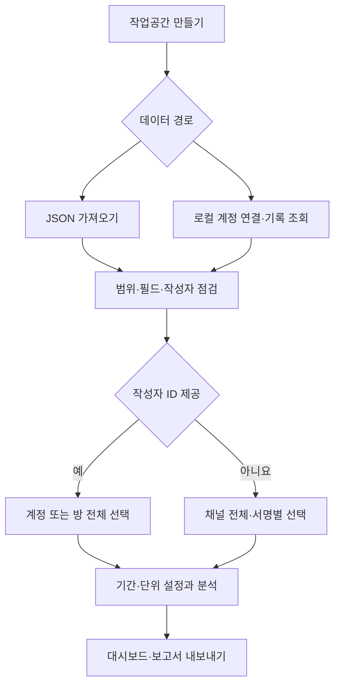
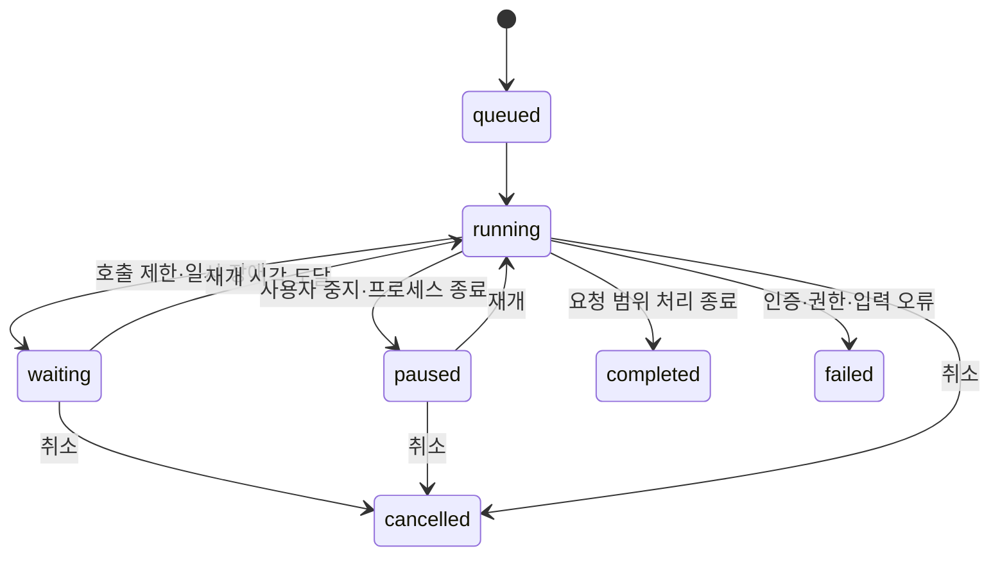

# PostScope — 텔레그램 게시 기록 분석 도구 개발 기획안

> 버전: 1.0 · 작성일: 2026-11-02 · 문서 성격: 구현을 위한 제품·데이터·검증 명세
>
> 접근 가능한 그룹·채널의 게시 기록을 바탕으로 날짜·요일·시간대별 분포를 분석한다. 특정 개인에 대한 해석은 API가 제공하는 계정 식별 범위를 넘지 않는다.

## 1. 프로젝트 목적과 최종 결과

사용자의 원래 요구는 **“텔레그램에서 특정 작성자가 올린 메시지를 모아 어느 날짜·요일·시간대에 많이 게시하는지 알아보기”**다.

이를 다음과 같은 도구로 구현한다.

1. 내보낸 JSON 또는 로그인한 계정에서 접근 가능한 API 기록을 읽는다.
2. 작성자 식별 가능 여부와 수집 범위를 먼저 보여준다.
3. 분석할 방·기간·작성자·게시물 유형·집계 단위를 선택한다.
4. 중복과 시간대를 정리하고 날짜별 추이·요일별 분포·시간대 히트맵을 만든다.
5. 분석 설정과 데이터 한계가 포함된 HTML 보고서 및 CSV를 내보낸다.

**최종 산출물은 게시 기록 분석 대시보드와 재현 가능한 통계 보고서다.** 파일 내용 분석, 실제 신원 확인, 사생활 추정은 요구사항에 포함하지 않는다.

대상 방의 링크·구조·표본은 아직 제공되지 않았다. 따라서 이 문서는 특정 방에서 전체 기록을 확보할 수 있다고 전제하지 않는다. 실제 데이터 연결을 제외한 기능은 합성 데이터로 먼저 완성할 수 있다.

## 2. 기본 결정 사항

| 항목 | 결정 |
| --- | --- |
| 제품명 | PostScope. 공식 텔레그램 제품으로 표시하지 않음 |
| 1차 사용자 | 기록을 분석하는 1명 |
| 실행 형태 | PC에서 실행하는 로컬 웹 앱 |
| 첫 데이터 경로 | Telegram Desktop JSON 내보내기 |
| 추가 데이터 경로 | 사용자 계정 API를 이용한 수동 수집·갱신 |
| 기본 분석 범위 | 방 1개, 작성자 전체 또는 식별 가능한 계정 1개 |
| 기본 시간대 | Asia/Seoul. 저장은 UTC |
| 기본 집계 단위 | 메시지 수. 앨범 식별자를 확보한 소스에서만 게시 묶음 수 제공 |
| 본문·첨부파일 | 본문과 첨부파일 바이너리는 저장·다운로드하지 않음 |
| 분석 방법 | 규칙과 기초 통계. 외부 AI 호출 및 모델 학습 없음 |
| 최종 내보내기 | 집계 CSV, 자체 포함형 HTML 보고서, 차트 PNG |
| 자동 예약 수집 | 초기 완성 범위에서 제외. 수동 갱신과 작업 재개까지 구현 |

분석 도구를 만드는 계획이며, 이 문서 작성만으로 계정 로그인·방 접근·데이터 수집이 실행되는 것은 아니다.

## 3. 실현 가능성의 근거와 사전 확인

공식 문서에서 확인한 기능은 다음과 같다. 세부 API 필드는 개발 시점에 다시 확인하고 사용 라이브러리 버전을 고정한다.

| 근거 | 제품에서의 사용 | 출처 |
| --- | --- | --- |
| Desktop의 JSON 내보내기 | 파일 가져오기 모드 | [S1] |
| `messages.getHistory` | 접근 가능한 방의 과거 기록 페이지 조회 | [S2] |
| `messages.search`의 작성자·날짜 필터 | 지원되는 경우 대상 기록 검색 | [S3] |
| 메시지의 작성자·게시 시각·앨범 정보 | 분리·집계·묶음 처리 | [S4] |
| 사용자 API의 앱 ID·해시 발급 | 로컬 계정 연결 | [S5] |
| 호출 제한과 인증 오류 | 대기·재개·중단 처리 | [S6] |

기록 조회와 작성자 검색은 사용자용 메서드다. Bot API를 과거 기록 수집의 대체 수단으로 사용하지 않는다. 봇이 받는 업데이트는 별도 방식이며 수신하지 않은 과거 대화 전체를 제공하는 이력이 아니다. [S2][S3][S7]

### 연결 전 판단표

| 확인 내용 | 성공 시 | 실패 시 |
| --- | --- | --- |
| 기록이 계정에서 열람되는가? | 표본 수집 | API 모드 중단, 보유한 JSON으로 분석 가능 여부 확인 |
| 그룹인가, 채널인가? | 소스 유형 저장 | 유형 미확인 상태로 유지하고 개인별 분석 보류 |
| 작성자 계정 ID가 있는가? | 계정 기준 필터 활성화 | 채널 전체 통계 또는 식별 불가 범주 사용 |
| JSON에 유효한 시각이 있는가? | 시간 통계 활성화 | 오류 행 격리. 전부 실패하면 가져오기 중단 |
| 앨범 식별자가 있는가? | 묶음 통계 활성화 | 메시지 수만 제공 |
| 요청한 기간을 조회했는가? | 접근 가능한 스냅샷의 조회 완료 표시 | 확보한 범위와 미조회 범위를 구분 |

**선행 확인 완료 기준:** 실제 표본 최대 200건을 확인하여 필드 매핑·작성자 구분·시간대 변환을 검증한다. 대상 계정의 기록이 적으면 확보한 전부를 표본으로 사용한다. 작성자 ID가 없으면 개인 분석이 가능하다고 표시하지 않는다.

## 4. 기능 범위와 우선순위

| ID | 기능 | 우선순위 | 완료 기준 |
| --- | --- | --- | --- |
| FR-01 | 단일 대화 JSON 가져오기 | 필수 | 지원 스키마를 탐지하고 행별 성공·실패 수 표시 |
| FR-02 | 여러 대화가 포함된 JSON 가져오기 | 필수 | 방을 분리하고 선택한 방만 가져오기 |
| FR-03 | 사용자 API 연결 | 필수 | 로컬 로그인, 연결 해제, 인증 만료 처리 |
| FR-04 | API 과거 기록 수집 | 필수 | 기간 제한·페이지 처리·중단 후 재개 |
| FR-05 | 수집 품질 점검 | 필수 | 범위·작성자 식별률·오류 수·앨범 지원 여부 표시 |
| FR-06 | 작성자·기간·유형 필터 | 필수 | 모든 차트·표·보고서에 같은 필터 적용 |
| FR-07 | 날짜·요일·시간대 분석 | 필수 | 정의된 집계 수식과 검증 예제 일치 |
| FR-08 | 메시지·게시 묶음 전환 | 필수 | 가능한 소스에서만 제공, 대체 집계를 명시 |
| FR-09 | 게시 간격과 연속 게시 묶음 | 필수 | 기준값 변경 시 결과 재계산 |
| FR-10 | 기간 비교 | 필수 | 동일 필터·관측 조건에서 두 기간 비교 |
| FR-11 | 보고서·CSV·PNG 내보내기 | 필수 | 집계와 분석 조건 재현에 필요한 정보 포함 |
| FR-12 | 새 기록 수동 갱신 | 필수 | 기존 메시지 중복 없이 추가·수정 반영 |
| FR-13 | 로컬 데이터 삭제·설정 보관 | 필수 | 방·작업공간별 데이터 및 세션 삭제 가능 |
| FR-14 | 장기 자동 예약 수집 | 후속 | 운영 환경·관측 정책이 정해진 뒤 구현 |
| FR-15 | 다중 사용자·공개 서비스 | 후속 | 계정별 격리·서버 운영 설계를 별도로 수행 |

초기 범위에 포함하지 않는 기능: 삭제된 기록 복원, 접근 제한 우회, PDF 원문·파일 재배포, 실명·전화번호·위치 추정, 온라인 상태 수집, 개인별 미래 행동 예측, 계정 간 동일인 추적.

## 5. 전체 사용자 흐름



### JSON 모드

1. Desktop에서 사용자가 열람 가능한 대화를 JSON으로 내보낸다. 미디어 파일은 내보내지 않아도 된다.
2. 앱에서 JSON 하나를 선택한다. 원본 파일 경로·파일 해시·크기·가져온 시각을 기록한다.
3. 여러 대화가 있으면 방 목록과 예상 행 수를 보여준다.
4. 앞부분만 읽은 미리보기와 전체 파싱 결과를 구분한다.
5. 시간대 정보·대상 기간·전체 내보내기 여부를 확인하는 설정을 제공한다. 알 수 없는 항목은 그대로 미확인으로 둔다.
6. 정규화된 최소 메타데이터만 저장한다. 앱이 만든 업로드 임시 복사본은 처리 후 삭제하고, 사용자가 가진 원본은 수정하지 않는다.

HTML 내보내기 입력은 v1에서 지원하지 않는다. JSON 내보내기를 안내한다. JSON의 필드 구성은 실제 파일로 검증하며, 없는 정보를 추정해 채우지 않는다. [S1]

### API 모드

1. 사용자가 직접 발급한 `api_id`, `api_hash`를 로컬 앱에 설정한다. [S5]
2. 계정 연결 화면에서 로그인 코드 및 필요한 2단계 인증을 처리한다. 코드를 개발자에게 전달하는 흐름은 두지 않는다.
3. 접근 가능한 방을 선택하고 `시작일·종료일`을 입력한다.
4. 표본 점검 결과를 먼저 표시한 다음 수집 작업을 실행한다.
5. 페이지 단위로 결과를 저장하며 진행 상황·마지막 성공 지점을 갱신한다.
6. 호출 제한 시 서버가 지정한 시각까지 대기하고, 앱을 다시 켜도 해당 대기를 유지한다.
7. 완료 후 조회 범위와 분석 가능한 대상을 표시한다.

작성자 검색이 실패하거나 방 유형에서 지원되지 않으면 접근 가능한 일반 이력 조회 후 로컬 필터를 적용한다. 검색 결과만으로 전체 기록이 확보되었다고 판정하지 않는다. 권한 오류는 더 넓은 권한 요청이나 우회 없이 해당 작업을 중단한다.

## 6. 작성자 식별 규칙

| 화면 분류 | 판단 기준 | 허용되는 설명 |
| --- | --- | --- |
| 사용자 계정 | 사용자형 sender peer ID 확보 | “해당 계정의 관측된 게시 기록” |
| 채널 계정 | 채널형 sender peer ID 확보 | “해당 채널 명의 게시 기록” |
| 서명 이름 | 서명 문자열만 확보 | “같은 서명 문자열이 표시된 게시물” |
| 식별 불가 | 유효한 sender 정보 없음 | “작성자 식별 불가” |

- 표시 이름과 사용자명은 바뀔 수 있으므로 계정의 기본 키로 사용하지 않는다.
- peer 유형과 ID를 함께 저장해 사용자·채널의 숫자 충돌을 피한다.
- 익명 관리자나 채널 명의 게시물을 실제 운영자 1명에게 연결하지 않는다.
- 같은 서명은 같은 사람의 증거가 아니다. 서명별 통계에는 항상 “개인 식별 정보 아님”을 표시한다.
- 전달 메시지의 원작성자와 현재 방에서 전달한 계정을 구분한다. 기본 필터는 **현재 방의 게시 주체**를 사용한다.
- ID가 없으면 이름만으로 합치지 않는다. 소스 내부의 서명 범주 또는 식별 불가로 남긴다.
- 기본 화면은 선택한 계정 1개 또는 방 전체를 분석한다. 다른 방을 뒤져 계정을 추적하는 기능은 만들지 않는다.

위 구분은 메시지의 sender peer, 전달 정보, 선택적 채널 서명을 이용하는 제품 규칙이다. [S4]

## 7. 저장 데이터와 스키마

### 7.1 최소 메시지 모델

| 필드 | 타입·예시 | 설명 |
| --- | --- | --- |
| workspace_id | UUID 문자열 | 로컬 작업공간 |
| source_id | UUID 문자열 | 가져오기 파일 또는 연결 소스 |
| chat_key | 문자열 | `peer_type:peer_id`; 소스에서 검증한 방 키 |
| message_id | 문자열 | 원본 메시지 ID. 없는 레코드는 별도 격리 |
| sender_kind | user/channel/signature/unknown | 작성자 분류 |
| sender_key | 문자열 또는 null | 확인된 peer 유형과 ID. 서명은 별도 키 사용 |
| signature_label | 문자열 또는 null | 선택적 표시 서명. ID 대용으로 사용하지 않음 |
| sent_at_utc | UTC 시각 | 실제 게시 시각 |
| edited_at_utc | UTC 시각 또는 null | 확보된 마지막 수정 시각 |
| expires_at_utc | UTC 시각 또는 null | 확인된 자동 만료 정보를 바탕으로 계산한 로컬 정리 시각 |
| album_key | 문자열 또는 null | 소스가 제공한 앨범 식별자 |
| content_kind | text/photo/document/video/audio/other/unknown | 메타데이터 기준 유형 |
| document_mime | 문자열 또는 null | 알려진 MIME만 사용 |
| is_forwarded | boolean 또는 unknown | 전달 여부 |
| is_service | boolean | 입퇴장·핀 고정 등 서비스 이벤트 |
| lifecycle | active/deleted/expired/unknown | 관측한 삭제·만료 상태 |
| first_seen_at / last_seen_at | UTC 시각 | 앱에서 확인한 시각 |
| provenance | 객체 | 가져오기 배치·소스 해시·파서 버전 |

메시지 본문, PDF 내용, 파일 바이너리, 인증 코드, 2단계 인증 비밀번호는 저장하지 않는다. 원본 JSON 전체를 DB나 로그에 복사하지 않는다.

문서 유형 필터는 MIME 등 확보한 속성으로 판단한다. PDF인지 확인할 정보가 없으면 `unknown`으로 둔다. 파일 확장자만으로 확정하거나 원문을 열어 검사하지 않는다.

### 7.2 저장 테이블

| 테이블 | 역할·핵심 제약 |
| --- | --- |
| workspaces | 제목, 시간대, 기본 단위, 작성 시각 |
| sources | JSON/API, 외부 스키마, 지원 필드, 소스 해시 |
| chats | peer 유형·ID와 화면용 별칭 |
| sender_labels | 계정 키와 표시 이름의 관측 이력 |
| messages | `workspace_id + chat_key + message_id` 고유 제약 |
| message_provenance | 메시지와 여러 수집 배치 연결 |
| imports | 파일 크기·해시·정상·중복·격리 건수 |
| collection_runs | 기간, 상태, 커서, 재시도 시각, 중단 사유 |
| observation_windows | 조회한 시간 구간·방·필터·관측 범위의 근거 |
| analysis_runs | 불변 설정 JSON·스냅샷 ID·알고리즘 버전 |
| report_snapshots | 최소 집계 결과와 생성 시각 |
| settings | 화면 설정·보존 정책. 로그인 비밀값 제외 |

수치형 ID는 DB에서는 충분한 정밀도로 저장하고, API JSON과 브라우저에서는 문자열로 전달한다. JavaScript의 큰 정수 반올림으로 메시지나 계정이 바뀌지 않도록 한다.

### 7.3 소스 충돌과 재가져오기

- 같은 파일 해시를 다시 가져오면 새 레코드를 만들지 않고 이전 결과를 안내한다.
- 서로 다른 파일에 같은 메시지가 있으면 기본 키로 병합하고 provenance를 추가한다.
- 방 ID를 확인할 수 없는 파일은 파일 소스 범위의 임시 방 키를 사용한다. API 방과 자동 병합하지 않는다.
- 시각·작성자 등 핵심 필드가 충돌하면 더 최근의 원본 수정 시각 등 명시적 근거로 선택한다. 우열을 정할 수 없으면 충돌 목록에 남기고 최신 관측본을 선택했다는 사실을 표시한다.
- 새 JSON에서 사라졌다는 이유만으로 메시지를 삭제 처리하지 않는다. 내보내기 범위가 달라졌을 수 있기 때문이다.

## 8. 정규화와 품질 처리

| 상황 | 처리 규칙 |
| --- | --- |
| JSON 숫자형·문자열형 ID 혼재 | 정규화 후 문자열로 통일 |
| Unix timestamp 제공 | 우선 UTC 시각으로 해석 |
| 시간대 포함 ISO 시각만 제공 | 해당 오프셋을 반영해 UTC 변환 |
| 시간대 없는 시각만 제공 | 사용자가 원본 시간대를 지정한 후 변환. 미지정이면 시간 분석에서 제외 |
| 여러 시각 필드가 불일치 | 조용히 하나를 택하지 않고 충돌 건수 표시 |
| 시각·ID 누락 또는 잘못된 값 | 격리 사유와 소스 행 번호 기록 |
| 서비스 메시지 | 기본 통계에서 제외하고 제외 건수 공개 |
| 텍스트 없는 파일 게시물 | 정상 게시물로 계산 |
| 수정 메시지 | 기존 행 갱신. 수정 시각을 새 게시 시각으로 세지 않음 |
| 알 수 없는 필드·유형 | 입력 자체는 유지 가능한 최소 메타데이터로 처리, 지원 상태 표시 |
| 삭제·만료 이벤트 관측 | 원본 메타데이터를 제거하거나 최소 tombstone으로 전환하고 현재 통계 재계산 |

JSON 크기 기본 제한은 100 MiB다. 제한 초과 시 조용히 앞부분만 처리하지 않고 기간 분할을 안내한다. API 이력은 스트리밍 배치 저장으로 처리하며 한 번에 전부 메모리에 올리지 않는다.

## 9. 관측 범위와 데이터 품질

### 9.1 “조회 완료”와 “완전한 기록” 구분

| 상태 | 의미 | 화면 표시 |
| --- | --- | --- |
| 접근 가능 스냅샷 조회 완료 | 요청 범위에서 API 페이지 처리가 정상 종료 | “접근 가능한 기록 조회 완료” |
| 부분 조회 | 중단·제한·오류로 일부만 확보 | “일부 구간 미조회” |
| 가져오기 범위 미확인 | 파일은 정상이나 전체 내보내기 여부 불명 | “내보내기 범위 미확인” |
| 확인된 관측 공백 | 지속 갱신 중 조회하지 못한 구간이 기록됨 | 해당 구간 회색 처리 |

정상적인 페이지 종료도 과거에 삭제되었거나 숨겨진 메시지가 없었다는 증거가 아니다. 메시지 ID의 빈 번호만으로 삭제 또는 수집 누락을 판정하지 않는다.

### 9.2 모든 보고서에 포함할 품질 정보

- 요청 기간, 실제 조회한 기간, 첫·마지막 관측 메시지 시각.
- 데이터 생성 시각, 소스 유형, 마지막 성공 갱신 시각.
- 처리·중복·격리·서비스 제외 건수.
- 작성자 ID 식별률과 서명만 있는 비율.
- 앨범 식별 지원 여부와 적용 단위.
- 관측 공백 및 JSON 내보내기 범위의 확인 상태.

“첫 메시지가 10월 3일이므로 10월 1~2일은 0건”처럼 추론하지 않는다. 파일의 기간 정보가 부족하면 앞뒤 구간은 관측 불명이다.

## 10. 집계 단위와 시간 경계

### 10.1 메시지 수와 게시 묶음 수

| 단위 | 정의 | 예시 |
| --- | --- | --- |
| 메시지 수 | 필터를 통과한 고유 메시지 수 | 앨범의 파일 메시지 5개 → 5건 |
| 게시 묶음 수 | 같은 방·작성 주체·앨범 키를 하나로 묶은 수 | 앨범 1개 → 1묶음 |

앨범이 없는 메시지는 각 1묶음이다. 앨범 ID가 없는 JSON에서는 가까운 게시 시각만으로 앨범을 추정하지 않는다. 해당 모드의 전환을 비활성화한다. [S4]

묶음 시각은 앨범 구성원 중 가장 이른 게시 시각이다. 묶음의 유형 필터는 “구성원 중 선택한 유형이 1개 이상 존재”로 정의한다. 전체 앨범을 형성한 뒤 묶음 시각에 기간 필터를 적용한다. 경계 주변의 앨범 구성원을 확인할 수 없으면 `불완전 앨범`으로 표시하고 묶음 통계에서 제외한다.

### 10.2 날짜·기간 경계

- UI에서 시작일~종료일은 양 끝 날짜를 포함한다.
- 내부 비교는 선택 시간대의 시작일 00:00 이상, 종료일 다음 날 00:00 미만인 반개구간 `[start, end)`을 UTC로 바꿔 적용한다.
- API의 날짜 경계 조건 차이에 대비해 경계와 겹치는 페이지를 읽고 로컬에서 정확히 필터링한다.
- 요일과 시간대는 UTC를 선택 시간대로 바꾼 후 계산한다.
- 조회·집계 도중 OS 시간대가 바뀌어도 결과가 달라지지 않아야 한다.
- 다른 시간대에서 일광절약시간제가 적용되면 반복·누락되는 시간은 UTC 구간으로 구분한 뒤 로컬 표시에 반영한다.

## 11. 분석 항목과 계산식

다음 수식은 이 프로젝트의 구현 명세다. 모델을 학습하거나 사람의 행동 원인을 추정하지 않는다. 모든 분석은 선택한 방·대상·기간·단위·유형·삭제 정책이 적용된 동일 데이터 집합을 사용한다.

### 11.1 기본 지표

| 지표 | 계산 | 주의사항 |
| --- | --- | --- |
| 총 관측 게시량 N | 선택 단위의 건수 합 | 삭제 제외·서비스 제외 건수를 함께 표시 |
| 관측 게시일 수 | 1건 이상 관측된 로컬 날짜 수 | 실제 활동일 수라고 부르지 않음 |
| 하루 평균 | N ÷ 조회 범위가 확인된 일수 | 범위 미확인 파일에서는 전체기간 평균을 숨김 |
| 시간당 게시율 | N ÷ 확인된 조회 범위의 시간 수 | 관측 공백과 미완료 구간 제외 |
| 최대 게시일 | 날짜별 건수 최댓값의 모든 날짜 | 동률을 임의로 1개만 고르지 않음 |
| 시간대 비중 | 해당 시간대 건수 ÷ N | N=0이면 계산 불가, 0%로 오해시키지 않음 |
| 게시 간격 중앙값 | 정렬한 관측 게시 시각의 인접 차 중앙값 | 2건 미만이면 계산 불가 |

평균 계산의 분모는 단순히 첫·마지막 메시지 사이 길이로 만들지 않는다. 조회한 구간의 근거가 있어야 한다. 기간 양 끝의 부분 날짜는 총시간 기반 평균에 포함할 수 있으나 “24시간 환산 평균”으로 표시한다. 완전한 날짜만 비교하는 모드도 제공한다.

### 11.2 날짜별·요일별·시간별

1. **날짜별 추이:** 일별 건수와 7일 이동평균. 이동평균은 해당 7일 모두 관측 범위가 확인될 때만 표시한다.
2. **요일별 분포:** 월~일 건수와 요일 출현 횟수로 나눈 1일 평균을 구분한다.
3. **시간대별 분포:** 0~23시 건수와 전체 게시 중 비중을 표시한다.
4. **요일×시간 히트맵:** 세로 7요일, 가로 24시간. 셀은 건수 또는 관측 시간당 게시율로 전환한다.
5. **자료 유형별 분포:** 텍스트·문서·사진 등 확보한 메타데이터 분류를 사용한다. 미확인 유형을 숨기지 않는다.

정규화된 히트맵 셀은 다음과 같이 계산한다.

```text
C(w, h) = 요일 w, 시각 h에 관측된 선택 단위의 게시 수
E(w, h) = 해당 셀에 속하는 확인된 조회 구간 길이의 합(시간)
R(w, h) = C(w, h) / E(w, h)
```

같은 방·필터의 겹치는 조회 구간은 합집합을 사용해 E를 중복 계산하지 않는다. E=0 또는 범위 미확인이면 R은 null이다. 빈칸·미관측·실제 관측 0건을 다른 상태로 표시한다. 여러 방을 섞는 정규화 통계는 v1에서 제공하지 않는다.

### 11.3 게시 간격

```text
정렬: (sent_at_utc 오름차순, message_id의 정규화된 순서)
Δi = ti - ti-1
출력: 중앙값, 25·75백분위, 최솟값, 최댓값, 구간별 빈도
```

- 같은 초에 여러 메시지가 있으면 간격 0초를 허용한다.
- 알려진 관측 공백을 가로지르는 간격은 요약 지표에서 제외한다.
- 범위 미확인 JSON의 간격은 “파일에 포함된 관측 게시 간격”이라고 표시한다.
- 미래 게시 시각·현재 온라인 여부·실제 휴식 시간을 계산하는 데 사용하지 않는다.

### 11.4 연속 게시 묶음

서로 가까운 게시가 얼마나 한꺼번에 나타나는지 보기 위한 설명 통계다.

| 규칙 | 정의 |
| --- | --- |
| 기본 임계값 | 인접 게시 간격 10분 이하 |
| 조정 범위 | 1~60분, 분석 설정에 저장 |
| 묶음 시작 | 첫 게시 또는 이전 게시와 임계값 초과 |
| 묶음 종료 | 다음 게시와 임계값 초과, 관측 공백, 분석 구간 끝 |
| 출력 | 묶음 수, 묶음당 게시 수 중앙값, 묶음 길이 분포 |

한 건짜리 묶음도 포함한다. 이 묶음은 “로그인 세션”이 아니며 운영자 수나 접속 시간을 뜻하지 않는다. 계정별 분석은 선택한 계정의 기록 안에서 계산한다.

### 11.5 기간 비교

- 기본 예시: 최근 완료된 14일과 그 직전 14일. 기본 예시는 데이터가 해당 기간을 포함할 때만 적용한다.
- 기간 A·B는 방·작성자·단위·유형·시간대가 같아야 한다.
- 두 기간이 겹치면 비교 실행 전에 안내하고 사용자가 기간을 수정하게 한다.
- 동일 기간 길이의 총량 비교와 관측 시간으로 나눈 게시율 비교를 구분한다.
- A=0, B>0이면 증감률은 “기준값 0으로 계산 불가”; 건수 차이는 표시한다.
- 일부 구간이 미관측이면 총량 비교의 한계를 표시하며 조건이 맞지 않는 정규화 지표를 숨긴다.
- 표본 30건 미만 또는 조회 범위 14일 미만이면 “짧은 기간·적은 표본” 배지를 표시한다. 이 기준은 제품 표시 규칙이며 통계적 신뢰도 보증 기준이 아니다.

### 11.6 설명 문장 생성

AI 대신 검증된 템플릿을 사용한다. 각 문장은 근거 지표와 필터를 참조한다.

> 예시: “분석 기간에 관측된 게시물 중 21~22시 게시 비중이 18.4%로 가장 높았습니다. 시간대: Asia/Seoul, 집계: 메시지 수.”

위 수치는 화면 설명을 위한 가상 값이다. 동률이면 모두 표시하고, N=0이면 설명을 만들지 않는다. “이 사람은 밤에 깨어 있다”, “다음 주에도 이 시간에 올릴 것이다”처럼 데이터가 뒷받침하지 않는 문장은 생성하지 않는다.

## 12. 화면 기획

화면의 기본 언어는 한국어다. 전문 용어 대신 ‘작성자 확인 가능’, ‘기록이 없는지 확인되지 않음’ 등 결과 해석에 필요한 설명을 사용한다.

| 화면 | 핵심 구성 | 주요 동작 |
| --- | --- | --- |
| ① 시작·작업공간 | 새 분석, 최근 분석, 데모 데이터 | 새 작업 생성·이어가기 |
| ② 데이터 가져오기 | JSON/API 탭, 파일 선택, 계정 연결 상태 | 미리보기·연결 해제 |
| ③ 표본·수집 설정 | 방 유형, 식별 가능 대상, 기간, 소스 지원 기능 | 대상 선택·수집 시작 |
| ④ 수집 진행 | 처리 수, 마지막 성공 시각, 대기·오류 사유 | 일시정지·재개·취소 |
| ⑤ 품질 점검 | 정상/중복/격리 수, 범위, 작성자·앨범 지원률 | 오류 사유 보기·분석 열기 |
| ⑥ 분석 대시보드 | 필터, 핵심 지표, 일별 추이, 히트맵, 시간·요일 분포 | 필터 적용·비교·차트 확대 |
| ⑦ 기록 표 | 가명 작성자, 게시 시각, 유형, 묶음 여부 | 페이지 이동·행별 메타데이터 확인 |
| ⑧ 보고서·설정 | 보고서 미리보기, 가명 설정, 내보내기, 데이터 삭제 | HTML/CSV/PNG 저장 |

### 12.1 대시보드 배치

1. 상단: 작업공간·방 별칭·데이터 기준 시각.
2. 필터: 대상, 시작·종료일, 시간대, 유형, 전달 포함 여부, 집계 단위.
3. 품질 상태: 범위 확인 여부·표본 수·식별률. 상세 내용은 펼치기로 제공한다.
4. 지표 카드: 총량, 관측 게시일, 관측 게시 간격 중앙값, 가장 많은 시간대.
5. 주 시각화: 날짜별 추이, 요일×시간 히트맵.
6. 보조 시각화: 요일별·시간대별 막대그래프, 게시 간격 분포.
7. 아래: 근거가 있는 자동 설명, 집계 표, 보고서 버튼.

필터는 ‘적용’ 버튼으로 확정하며 결과는 적용된 설정을 기준으로 고정한다. 수정 중인 필터와 현재 결과의 조건이 다르면 “필터 변경 미적용”으로 표시한다. 새 계산이 끝나기 전에 이전 결과에 새 필터 이름을 붙이지 않는다.

### 12.2 비정상·빈 상태

| 상황 | 화면 동작 |
| --- | --- |
| 기록 0건 | 오류 대신 조건과 0건 결과 표시, 간격·비중은 계산 불가 |
| 기록 1건 | 해당 날짜·시각은 표시, 간격은 숨김 |
| 일부 행 오류 | 정상 데이터 분석 허용, 제외 수를 상단·보고서에 표시 |
| 작성자 ID 없음 | 개인 계정 선택 비활성화, 채널·서명 범주 제공 |
| 범위 미확인 | 관측 건수 차트 제공, 일평균·관측 보정 비교 제한 |
| API 대기 | 다시 시도 가능 시각과 재개 버튼 상태 표시 |
| 연결 만료 | 재연결 안내, 이미 저장된 데이터 분석은 계속 가능 |
| 취소·실패 | 저장한 범위까지 사용 가능하며 미완료 표시 유지 |

### 12.3 시각·접근성 기준

- 기본 밝은 화면, 대비가 충분한 파랑 계열 차트. 어두운 화면은 후속 선택 기능이다.
- 미관측은 회색 사선 또는 라벨, 관측 0건은 축척의 0색으로 구분한다.
- 색상만으로 상태를 구별하지 않고 텍스트·아이콘을 함께 사용한다.
- 히트맵 값은 키보드로 탐색하거나 동일 값의 표로 읽을 수 있어야 한다.
- 차트 툴팁에 시간대·단위·분모를 표시한다.
- 화면 폭 360px부터 가로 넘침 없이 사용한다. 히트맵만 필요한 경우 독립 가로 스크롤과 표 전환을 제공한다.
- 로컬 앱의 휴대폰 외부 접속은 기본 제공하지 않는다. 모바일 화면 크기 대응과 네트워크 공개는 별도 기능이다.

## 13. 기술 구조와 모듈

### 13.1 선택 기술

| 계층 | 선택 | 선택 이유 |
| --- | --- | --- |
| 서버 | Python + FastAPI + Uvicorn | 비동기 수집과 데이터 처리를 같은 언어에서 구현 |
| 화면 | Jinja2 + 로컬 CSS + JavaScript 모듈 | 초기 규모에 맞게 빌드·배포 부담 축소 |
| API 연결 | Telethon 안정 계열 + 자체 어댑터 | 사용자 이력 조회·로그인·이벤트 처리를 감춤 |
| 저장 | SQLite + 명시적 마이그레이션 | 단일 사용자, 서버 설치 불필요 |
| 집계 | SQLite 쿼리 + Python 표준 통계 | 대량 원본을 브라우저로 보내지 않음 |
| 화면 차트 | 로컬 번들 Plotly.js | 히트맵·확대·데이터 탐색 |
| PNG 차트 | Matplotlib, 한글 폰트 포함 | 브라우저·추가 변환 서버 의존 축소 |
| 테스트 | pytest + Playwright | 계산·복구·실제 사용자 흐름 검증 |
| 실행 패키지 | 버전 잠금 의존성 + Windows/Linux 실행 스크립트 | 반복 가능한 설치·기동 |

Telethon 문서는 이력 반복 조회와 작성자 검색 경로, 호출 제한 대기 설정을 제공한다. SDK의 기본 자동 대기와 자체 작업 상태가 충돌하지 않도록 어댑터에서 대기를 일원화한다. 라이브러리의 예시 호출 빈도를 텔레그램의 보장된 제한으로 해석하지 않는다. [S9]

실제 의존성 버전은 구현 시작 시 호환성을 확인하여 잠금 파일로 기록한다. 알파 버전과 문서에 없는 가상 API는 사용하지 않는다.

### 13.2 모듈 책임

| 모듈 | 책임 |
| --- | --- |
| `adapters/desktop_json` | 두 가지 JSON 구조 탐지, 스트리밍 파싱, 소스 필드 매핑 |
| `adapters/telegram` | 로그인·방 조회·페이지 수집·이벤트 수신 |
| `services/normalizer` | ID·시간·유형·작성자 표준화 |
| `services/collector` | 작업 상태·커서·대기·재개·취소 |
| `services/quality` | 범위·충돌·격리·식별률 산출 |
| `services/analysis` | 단위·필터·통계·템플릿 설명 |
| `services/reports` | 집계 스냅샷·HTML·CSV·PNG 생성 |
| `storage` | 트랜잭션·마이그레이션·삭제·보존 |
| `web` | 입력 검증·작업 API·화면 렌더링 |
| `tests/fixtures` | 실제 서비스 데이터가 없는 합성 샘플 |

화면은 DB나 SDK를 직접 호출하지 않는다. 분석 엔진은 JSON/API 소스와 무관하게 같은 정규 모델만 사용한다.

### 13.3 내부 HTTP 계약

다음 경로는 앱 내부용 설계이며 텔레그램의 API 경로가 아니다. 모든 데이터 요청은 작업공간 접근 검증을 거친다.

| 메서드·경로 | 입력 | 결과 |
| --- | --- | --- |
| `POST /api/workspaces` | 제목·시간대 | 작업공간 ID |
| `POST /api/imports` | workspace ID·파일 | 가져오기 작업 ID, HTTP 202 |
| `POST /api/connections/login` | 계정 연결 입력 | 로그인 단계 상태 |
| `POST /api/connections/verify` | 일회성 로그인 입력 | 연결 상태 |
| `GET /api/chats` | 연결 ID | 접근 가능한 방의 페이지 목록 |
| `POST /api/collections` | 방·시작·종료·선택적 작성자 | 수집 작업 ID, HTTP 202 |
| `GET /api/jobs/{id}` | 작업 ID | 상태·처리 수·재개 시각·품질 요약 |
| `POST /api/jobs/{id}/actions` | pause/resume/cancel | 변경된 작업 상태 |
| `POST /api/analyses` | 정규 분석 설정 | 불변 분석 ID·집계 결과 |
| `GET /api/analyses/{id}/records` | 커서·페이지 크기 | 본문 없는 메타데이터 목록 |
| `POST /api/reports` | 분석 ID·형식·가명 옵션 | 보고서 ID·저장 상태 |
| `GET /api/reports/{id}/download` | 보고서 ID | 생성된 파일 |
| `DELETE /api/workspaces/{id}` | 삭제 의사 확인값 | 삭제 결과 |
| `DELETE /api/connections/{id}` | 연결 ID | 세션 삭제·연결 해제 결과 |

작업 상태는 2초 폴링으로 갱신한다. 긴 수집을 HTTP 응답 안에서 계속 실행하지 않는다. 분석 ID는 적용 필터·스냅샷·알고리즘 버전과 연결한다. ID 필드는 JSON 문자열, 시각은 UTC ISO 8601로 주고받는다.

## 14. 수집 작업과 장애 복구

### 14.1 상태 전이



완료한 작업의 범위를 늘릴 때는 기존 작업을 수정하지 않고 새 작업을 만든다. 실패한 인증·권한을 해결한 뒤에도 기존 종료 결과를 보존하고 재시도 작업으로 연결한다.

### 14.2 페이지 저장과 커서

1. 수집 시작 시 요청 범위와 기준 시각을 고정한다.
2. 한 계정에 수집 worker 1개만 허용한다. 여러 작업은 큐에 둔다.
3. 페이지를 받으면 정규화·upsert·provenance·커서 갱신을 같은 트랜잭션에서 커밋한다.
4. 커밋 전에 종료되면 페이지 전체를 다시 읽는다. 고유 키로 중복을 제거한다.
5. 재개 시 마지막 커밋 페이지와 조금 겹치게 조회한 뒤 중복 제거한다.
6. 과거 방향 커서와 새 기록 갱신 커서를 분리한다. 새 게시물이 생겨도 과거 페이지 위치를 잃지 않는다.
7. 완료 백분율을 계산할 전체 개수가 확실하지 않으면 처리 수와 도달 시각만 보여준다.

### 14.3 대기·오류 정책

| 오류 | 동작 |
| --- | --- |
| 호출 제한 | 서버가 요구한 대기만큼 기다림. `next_retry_at` 저장. 앱 재시작으로 대기를 우회하지 않음 |
| 네트워크 일시 오류 | 2·4·8·16·32초 기준 지연에 작은 무작위 지연 추가, 5회 후 paused |
| 세션 만료·취소 | failed 처리, 재로그인 안내. 자동 로그인 반복 금지 |
| 방 접근 불가 | 해당 작업 종료, 이미 확보한 데이터는 출처와 부분 상태를 유지 |
| 잘못된 입력 | 시작 전에 검증. 요청 범위·시간대 오류를 구체적으로 표시 |
| 디스크 부족·DB 잠금 | 새 작업 중지, 커밋된 지점 보존, 해결 후 재개 |
| JSON 형식 오류 | 전체 취소 또는 정상 행만 가져오기 여부를 명확히 제시 |

호출 속도는 계정·메서드별 제한을 존중하며 조정한다. 여러 계정·프록시를 돌려 호출 제한을 회피하는 구조는 만들지 않는다. [S6]

### 14.4 수정·삭제·만료 반영

- 연결 중에는 SDK 업데이트를 받아 관측한 수정·삭제를 반영한다. 업데이트 공백은 SDK의 지원 범위에서 복구하고 결과를 기록한다. [S8]
- 앱이 꺼진 동안의 삭제·수정을 전부 알아낼 수 있다고 보장하지 않는다.
- 수동 갱신은 새 게시물을 추가하고 최근 7일의 접근 가능한 기록을 재점검한다. 최근 범위 재조회만으로 오래된 기록의 삭제 여부까지 판정하지 않는다.
- 특정 메시지의 삭제를 직접 확인할 수 없는 오류는 삭제 확정으로 취급하지 않는다.
- 자동 만료 정보가 있는 메시지는 만료 시점에 로컬에서도 제거한다. 재시작 시 분석 전에 만료 데이터를 정리한다. [S4]
- 현재 통계는 관측된 삭제를 제외한다. 기존 보고서는 생성 당시 집계 스냅샷임을 명시하며 현재 결과와 구분한다.

## 15. 로컬 실행·계정·보존 정책

이 도구는 계정에서 볼 수 있는 메타데이터를 읽는 동작만 구현한다. **사용자 세션 자체에 읽기 전용 권한이 부여되는 것은 아니다.** 따라서 SDK 인스턴스는 전용 어댑터에만 두고 메시지 전송·삭제·초대 메서드를 앱 기능으로 노출하지 않는다.

| 항목 | 구현 기준 |
| --- | --- |
| 서버 노출 | 기본 `127.0.0.1`, 개발용 공개 터널 자동 생성 없음 |
| 로컬 요청 보호 | 실행 토큰, 상태 변경 요청의 Origin·CSRF 검증, 허용 Host 제한 |
| 로그인 비밀값 | 서버 메모리에서만 단기 사용. 로그·보고서·브라우저 저장소에 남기지 않음 |
| 세션 보관 | OS 보안 저장소 지원 시 세션 문자열 보관. 미지원 시 메모리 세션으로 실행 후 종료 시 해제 |
| 세션 파일 | 평문 `.session` 파일을 분석 DB·내보내기·백업에 넣지 않음 |
| 표시·보고서 | 기본 `계정 A`, `채널 A` 가명 사용. 실 ID 포함 내보내기는 별도 선택 |
| 데이터 보존 | 앱에서 마지막으로 확인한 시점부터 기본 90일. 보존 기간 변경 가능, 자동 제거 시 분석 가능 기간 표시 |
| 작업공간 삭제 | 메시지·provenance·집계·생성 파일을 함께 제거 |
| 계정 연결 해제 | 저장 세션을 지우고 가능하면 해당 앱 세션 로그아웃. 네트워크 실패 시 로컬 삭제와 원격 해제 여부를 나눠 표시 |
| 백업 | 사용자가 선택한 최소 분석 데이터·설정만. 인증 비밀값 제외 |

SDK 세션에는 로그인에 필요한 민감한 정보가 포함될 수 있으므로 일반 데이터와 다른 보관 경로를 사용한다. [S10]

내보내기와 화면은 외부 CDN·분석 추적기·AI 서버로 메시지 정보를 전송하지 않는다. 표시 이름·서명·파일에서 읽은 문자열은 HTML 이스케이프한다. CSV 문자열은 수식으로 실행될 수 있는 선행 문자를 안전하게 처리한다. 다운로드 경로는 임의의 파일 경로 입력이 아닌 서버가 발급한 보고서 ID로 제한한다.

API 사용은 공식 서비스 약관과 연결 계정의 접근 범위를 전제로 한다. 현행 API 약관은 AI·기계학습 관련 데이터 사용을 제한하므로, 이 기획은 원문 외부 전송·모델 학습·AI 요약·ML 예측 기능 없이 결정적 집계로 구성한다. 실제 서비스 배포 단계에서는 적용되는 약관을 다시 확인한다. [S11]

## 16. 보고서와 내보내기 명세

### 16.1 HTML 보고서

보고서 하나에 다음 정보를 포함한다.

1. 제목·생성 시각·데이터 스냅샷 시각·도구 버전.
2. 선택한 방 별칭·작성자 범주·분석 기간·시간대·집계 단위·유형.
3. 출처·조회 범위·정상·제외·격리 건수·작성자 식별률.
4. 핵심 지표와 4개 기본 차트: 일별 추이, 요일 분포, 시간 분포, 요일×시간 히트맵.
5. 관측 게시 간격·연속 게시 묶음·선택한 기간 비교.
6. 근거 값에 연결된 템플릿 설명.
7. 해석 한계·필터·알고리즘 버전·스냅샷 ID.

차트 스크립트·스타일·가공된 집계 데이터를 파일에 포함해 오프라인에서 열린다. 원본 메시지·세션·계정 비밀값은 포함하지 않는다. 첫 페이지에 “생성 시점 스냅샷”임을 표시한다.

### 16.2 CSV와 PNG

| 파일 | 내용 |
| --- | --- |
| `summary.csv` | 지표·값·단위·계산 가능 여부 |
| `daily.csv` | 로컬 날짜·건수·관측 상태·관측 시간 |
| `weekday_hour.csv` | 요일·시간·건수·분모·게시율 |
| `intervals.csv` | 관측 간격·계산에 포함 여부·제외 이유 |
| `analysis_config.json` | 필터·범위·시간대·버전·가명 설정. 인증 정보 제외 |
| `charts/*.png` | 한국어 글꼴이 적용된 차트, 1600px 이상 너비 |

여러 내보내기는 ZIP으로 묶는다. CSV는 UTF-8 BOM을 사용하고 시각 열에 시간대를 명시한다. 백분율 원값과 표시 반올림 규칙을 구분한다. 가명 매핑은 기본 ZIP에 포함하지 않는다.

동일 스냅샷과 설정으로 다시 내보내면 생성 시각·파일 ID를 제외한 집계 값이 같아야 한다. 삭제·보존 정책으로 원본이 달라지면 이전 스냅샷과 동일한 원본 재분석을 보장하지 않으며, 보관된 집계로 보고서를 재생성했음을 표시한다.

## 17. 비기능 요구사항

아래 수치는 **설계·검수 목표이며 실제 측정 결과가 아니다.** 기준 장비는 4코어 CPU·메모리 8GB·SSD의 로컬 PC로 고정하고 버전·데이터 크기를 측정 기록에 남긴다.

| 항목 | 목표 |
| --- | --- |
| 오프라인 입력 규모 | 100 MiB 이하 지원 JSON, 10만 건 검수 데이터 |
| 저장 후 기본 집계 | 10만 건에서 3초 이내 목표 |
| 필터 변경 후 표시 | 캐시 적중 시 1초 이내, 재계산 시 3초 이내 목표 |
| JSON 10만 건 가져오기 | 기준 장비에서 60초 이내 목표 |
| 메모리 | 가져오기·기본 집계 중 앱 프로세스 RSS 1GiB 이하 목표 |
| 기록 표 | 기본 50행, 요청당 최대 200행, 커서 기반 페이지 이동 |
| 취소 반응 | UI에서 즉시 요청 접수. 진행 중 요청은 최대 네트워크 타임아웃 30초 뒤 정지 가능 |
| API 전체 수집 시간 | 호출 제한·기록량에 따라 달라지므로 고정 완료 시간 보장 없음 |
| 재실행 | 앱 비정상 종료 후 DB 일관성 유지, 중복 없이 작업 재개 |
| 설치 | Windows·Linux에서 잠금 의존성으로 설치·기동 검증 |
| 오프라인 분석 | JSON 입력과 저장된 데이터 분석은 인터넷 없이 가능 |

성능을 위해 브라우저에는 집계와 현재 페이지 데이터만 전달한다. 날짜·방·작성자 인덱스를 두고, 분석 캐시 키에 데이터 리비전과 전체 필터를 포함한다. 수집·삭제·수정이 발생하면 관련 캐시를 무효화한다.

분석 실행은 SQLite의 일관된 읽기 트랜잭션에서 데이터와 리비전을 함께 고정한다. 계산 도중 수집된 데이터는 다음 분석부터 반영한다. 오래 걸리는 보고서 생성은 확정된 집계 스냅샷을 사용하며 DB 쓰기 잠금을 유지하지 않는다.

## 18. 검증 데이터와 테스트 명세

테스트는 합성 데이터로 자동 실행한다. 실제 계정 검증은 사용자가 연결한 접근 가능한 방에서 별도로 수행한다. 외부 서비스의 전체 기록 확보를 합성 테스트 통과만으로 주장하지 않는다.

### 18.1 기준 합성 데이터

같은 방의 사용자 계정 A에 다음 메시지 5개를 만든다.

| ID | UTC 게시 시각 | 한국 시각 | 앨범 | 유형 |
| --- | --- | --- | --- | --- |
| 1 | 2026-11-01 14:59:00Z | 11/01 23:59 | 없음 | text |
| 2 | 2026-11-01 15:00:00Z | 11/02 00:00 | G1 | document |
| 3 | 2026-11-01 15:00:30Z | 11/02 00:00:30 | G1 | document |
| 4 | 2026-11-02 03:00:00Z | 11/02 12:00 | 없음 | text |
| 5 | 2026-11-02 15:00:00Z | 11/03 00:00 | 없음 | photo |

분석 범위를 한국 시간 **11월 2일 하루**로 설정하면 다음이 성립해야 한다.

- 메시지 수: 3건(ID 2·3·4). 게시 묶음 수: 2묶음(G1과 ID 4).
- 요일: 월요일. 시간 분포: 00시 2건, 12시 1건.
- 원시 메시지 간격: 30초, 43,170초. 중앙값: 21,600초.
- 문서 필터의 메시지 수: 2건, 게시 묶음 수: 1묶음.
- ID 1과 ID 5는 각각 시작 경계 이전·종료 경계에 해당하여 제외.

추가로 다른 사용자 B, 익명 채널 게시물, 서비스 이벤트, 잘못된 날짜, 같은 파일 재가져오기, 앨범 경계 분할 사례를 넣는다.

### 18.2 필수 검수 사례

| ID | 검증 대상 | 합격 기준 |
| --- | --- | --- |
| QA-01 | UTC·한국 시간 경계 | 위 기준 데이터의 건수·요일·간격과 정확히 일치 |
| QA-02 | 재가져오기 | 같은 파일 2회 처리 후 고유 메시지 수 동일 |
| QA-03 | 작성자 변경 이름 | ID가 같으면 계정 필터 동일, 이름만 같으면 자동 병합 안 함 |
| QA-04 | 채널·익명·서명 | 개인으로 오표시하지 않고 식별 상태 유지 |
| QA-05 | 앨범 | 묶음 중복 제거, ID 없는 소스는 전환 비활성화 |
| QA-06 | 관측 공백 | 빈 구간을 0건으로 채우지 않고 분모에서 제외 |
| QA-07 | 기간 비교 | 기준값 0·겹친 기간·다른 시간대 처리 일치 |
| QA-08 | 작업 중 프로세스 종료 | 재시작 후 커밋 지점에서 재개, 중복 없음 |
| QA-09 | 호출 제한 | 모의 오류의 대기 시각 이전 호출 없음, 재시작 후에도 유지 |
| QA-10 | 인증·접근 만료 | 반복 요청 중단, 기존 분석 가능, 세션 상태 명확 |
| QA-11 | 수정·삭제·만료 | 현재 집계와 캐시 갱신, 보고서 스냅샷 구분 |
| QA-12 | 잘못된 입력 | 행별 격리, 파일 전체 일부 처리 여부 명시 |
| QA-13 | 출력 안전성 | HTML 문자열 이스케이프, CSV 수식 실행 방지, 비밀값 없음 |
| QA-14 | 차트·표·CSV 일치 | 반올림 전 집계 값 동일, 차트별 필터 일치 |
| QA-15 | 오프라인 보고서 | 인터넷 차단 상태에서 모든 차트·한국어 표시 |
| QA-16 | 0·1건·대용량 | 예외·NaN·무한대 없이 정의된 결과 표시 |
| QA-17 | 큰 정수 ID | 브라우저 왕복 후 문자열 값이 동일 |
| QA-18 | 키보드·작은 화면 | 주요 흐름 조작 가능, 필터·값이 잘리지 않음 |
| QA-19 | 동시 갱신 중 분석 | 하나의 일관된 데이터 스냅샷으로 계산 |
| QA-20 | 삭제·연결 해제 | 작업공간 파일 제거, 세션 비밀값이 백업·로그에 없음 |

### 18.3 실제 데이터 인수검사

1. 계정 연결 또는 실제 JSON 1개를 가져온다.
2. 특정 날짜의 접근 가능한 메시지를 직접 대조한다. 표본 100건 또는 확보된 전부를 사용한다.
3. 무작위로 고른 메시지의 작성자·게시 시각·유형을 화면과 비교한다.
4. 알 수 없는 필드는 미확인으로 표시되는지 확인한다.
5. 같은 범위 재수집과 중단·재개를 한 번 수행한다.
6. 생성 보고서의 총량·히트맵 합계·CSV 합계가 일치하는지 확인한다.

실제 방 자료를 확보하지 못하면 “합성 데이터 검증 완료, 대상 방 검증 미완료”로 납품 상태를 구분한다.

## 19. 구현 단계와 예상 일정

1인 개발·기본 UI·로컬 실행·유효한 연결 계정과 표본 제공을 가정한 **계획 추정치**다. API 대기·권한 문제·낯선 JSON 구조에 따라 늘어날 수 있다.

| 단계 | 작업 | 예상 작업일 | 단계 산출물 |
| --- | --- | --- | --- |
| 0 | 표본 확인·필드 매핑·기술 경로 검증 | 0.5~1 | 연결 가능성 결과·지원 필드 표 |
| 1 | 작업공간·DB·JSON 파서·품질 점검 | 2~3 | JSON 입력부터 정규화까지 |
| 2 | 분석 엔진·필터·기준 데이터 검증 | 2 | 정확한 집계 결과와 테스트 |
| 3 | 대시보드·표·보고서·CSV | 2~3 | 오프라인 분석 가능한 초기 버전 |
| 4 | 사용자 API·수집 작업·재개·갱신 | 3~4 | API 데이터 수집·복구 흐름 |
| 5 | 통합·실제 표본·성능·설치 검증 | 2~3 | 인수검사 기록·배포 패키지 |

전체 예상은 약 12~16 작업일이며 반일 수준의 차이는 버퍼로 처리한다. **초기 확인 가능한 버전은 단계 1~3의 JSON 분석 버전**이다. API 연결이 막혀도 해당 버전은 사용할 수 있다. 단계 4는 합성 어댑터로 먼저 구현할 수 있지만 실제 연결 완료로 표기하지 않는다.

작업 순서의 의존성은 `스키마 → 정규화 → 집계 → 화면·보고서`다. API 수집은 같은 정규화 인터페이스에 연결하므로 화면 전체를 다시 만들 필요가 없다.

## 20. 위험과 대체 경로

| 위험 | 영향 | 대응 |
| --- | --- | --- |
| 대상 방 접근 불가 | API 수집 불가 | 사용자가 가진 내보내기 파일 분석, 미확보 범위 명시 |
| 작성자가 채널로만 표시 | 개인별 분석 불가 | 채널 전체·서명별 통계로 기능 축소 |
| 오래된 기록이 일부 없음 | 전체 기간 해석 제한 | 접근 가능한 스냅샷만 보고, 완전성 주장 금지 |
| JSON 스키마 차이 | 특정 파일 파싱 실패 | 버전별 어댑터, 지원 필드 탐지, 표본 고정 |
| API 호출 제한 | 수집 지연 | 영속 대기 상태·사용자 취소·재개 |
| 예약·공동 게시 | 운영자 해석 왜곡 | 게시 기록 수준으로만 설명 |
| 앨범 키 미제공 | 묶음 수 산출 불가 | 메시지 수 제공, 추정 묶음 사용 안 함 |
| 데이터 정리로 과거 원본 제거 | 과거 원본 재분석 제한 | 최소 집계 스냅샷 보관·보존 범위 표시 |
| 브라우저에서 대량 처리 | 느려짐·메모리 증가 | 서버 집계·커서 페이지·규모별 검수 |
| 세션 유출 | 연결 계정에 영향 | 로컬 비밀 저장소·메모리 세션·로그 제거·해제 기능 |

## 21. 최종 납품물

| 산출물 | 내용 |
| --- | --- |
| 소스 코드 | 화면·수집·분석·보고서·DB 마이그레이션 |
| 의존성 잠금 파일 | 검증된 정확한 설치 버전 |
| 실행 스크립트 | Windows·Linux에서 로컬 기동 |
| 합성 데모 자료 | JSON·API 모의 데이터·기대 집계 |
| 사용자 안내 | 설치·JSON 내보내기·계정 연결·보고서·삭제 방법 |
| 개발자 명세 | 필드 매핑·내부 API·집계 정의·상태 전이 |
| 검수 결과 | 자동 테스트·성능·실제 표본 검증의 수행 여부와 결과 |
| 예시 보고서 | 가상 데이터임을 명시한 HTML·CSV·PNG |

## 22. 최종 완료 판정

- [ ] JSON 입력으로 방·대상·기간을 선택하고 4개 기본 차트를 얻는다.
- [ ] API에서 접근 가능한 이력을 읽고 중단·재개·갱신할 수 있다.
- [ ] 개인 계정·채널·서명·식별 불가를 혼동하지 않는다.
- [ ] 시간 경계·중복·앨범·서비스 이벤트를 명세대로 처리한다.
- [ ] 기록 미관측과 관측된 0건을 분리한다.
- [ ] 모든 차트·표·CSV가 같은 스냅샷·필터·단위를 사용한다.
- [ ] 보고서를 인터넷 없이 열고 설정·품질 정보를 확인할 수 있다.
- [ ] 인증 만료·호출 제한·작업 종료 후 데이터 일관성이 유지된다.
- [ ] 실제 자료와 합성 자료의 검증 결과를 나눠 제시한다.
- [ ] 비밀값·본문·첨부 바이너리가 로그·백업·보고서에 포함되지 않는다.
- [ ] 설치·실행·연결 해제·작업공간 삭제를 검증한다.
- [ ] 성능 목표의 실제 측정값과 미달 항목을 기록한다.

기능 구현 완료와 특정 방의 데이터 확보 완료는 따로 판정한다. 제품 기능이 완성되어도 해당 방에 작성자 정보가 없으면 개인별 분석은 제공할 수 없다.

## 23. 개발 착수 시 확정할 입력

다음은 설계가 끝나지 않아 남겨 둔 항목이 아니라, 실제 대상에 연결하기 위해 필요한 외부 입력이다. 다른 모듈은 합성 자료로 먼저 개발한다.

| 입력 | 필요한 이유 | 미제공 시 진행 방식 |
| --- | --- | --- |
| 대상 그룹·채널 식별 정보 | 분석할 방 선택 | 합성 방·JSON 분석 경로 개발 |
| 접근 가능한 계정 또는 내보낸 JSON | 실제 데이터 수집 | 계정 연결 UI·모의 어댑터 개발 |
| 개인 계정별 또는 채널 전체 분석 의도 | 필터 범위 확정 | 식별 가능한 계정 선택과 방 전체 모두 구현 |
| 실제 분석 시작·종료일 | 수집 범위 제한 | 지원되는 임의 기간 선택 UI 구현 |
| 원본 시각의 시간대 | 일부 JSON 시각 해석 | 명시적 오프셋·Unix 시각 우선, 불명은 사용자 지정 필요 |

**착수 기준:** JSON 기반 분석 도구를 먼저 완성하고, 같은 데이터 모델에 사용자 API 수집기를 연결한다. 대상 방의 실현 가능성은 표본과 접근 권한으로 확인하며, 확인되지 않은 부분을 추정해 성공으로 처리하지 않는다.

## 24. 공식·개발 문서 근거

확인일: 2026-11-02. 아래 자료는 기능의 존재와 제약을 확인하는 근거다. 이 문서의 UI·스키마·수식·일정·성능 목표는 프로젝트 설계이며 공식 서비스의 보장 사항이 아니다.

| 표기 | 문서 | 이 기획에서 확인한 내용 |
| --- | --- | --- |
| S1 | [Telegram: Chat Export Tool](https://telegram.org/blog/export-and-more) | Desktop에서 대화 JSON·HTML 내보내기 |
| S2 | [messages.getHistory](https://core.telegram.org/method/messages.getHistory) | 사용자 계정의 과거 이력 조회와 접근 오류 |
| S3 | [messages.search](https://core.telegram.org/method/messages.search) | 작성자·날짜 필터, 사용자 메서드 제약 |
| S4 | [Message constructor](https://core.telegram.org/constructor/message) | 게시·수정 시각, 선택적 작성자·서명·앨범·만료 정보 |
| S5 | [Creating your Telegram Application](https://core.telegram.org/api/obtaining_api_id) | 사용자 API 앱 ID·해시 발급 |
| S6 | [Telegram API: Error handling](https://core.telegram.org/api/errors) | 인증·권한·호출 대기 오류 |
| S7 | [Telegram Bot API](https://core.telegram.org/bots/api) | 업데이트 수신 방식과 보관 제한 |
| S8 | [Working with Updates](https://core.telegram.org/api/updates) | 업데이트 처리·누락 복구의 제약 |
| S9 | [Telethon: TelegramClient](https://docs.telethon.dev/en/stable/modules/client.html) | 이력 반복 조회·검색 경로·대기 설정 |
| S10 | [Telethon: Session Files](https://docs.telethon.dev/en/stable/concepts/sessions.html) | 세션 보관 방식과 민감한 인증 정보 |
| S11 | [Telegram API Terms of Service](https://core.telegram.org/api/terms) | 프라이버시·앱 식별·AI 관련 사용 제한 |
| S12 | [Uvicorn Settings](https://uvicorn.dev/settings/) | 로컬 host 설정 |


